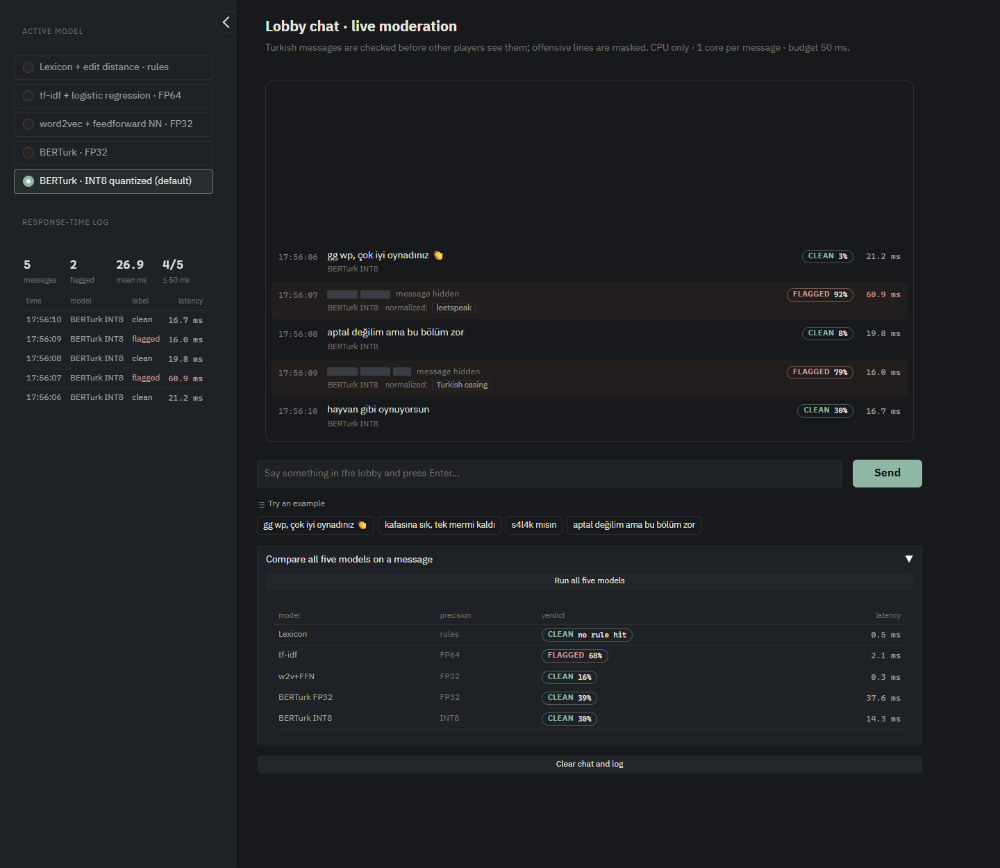
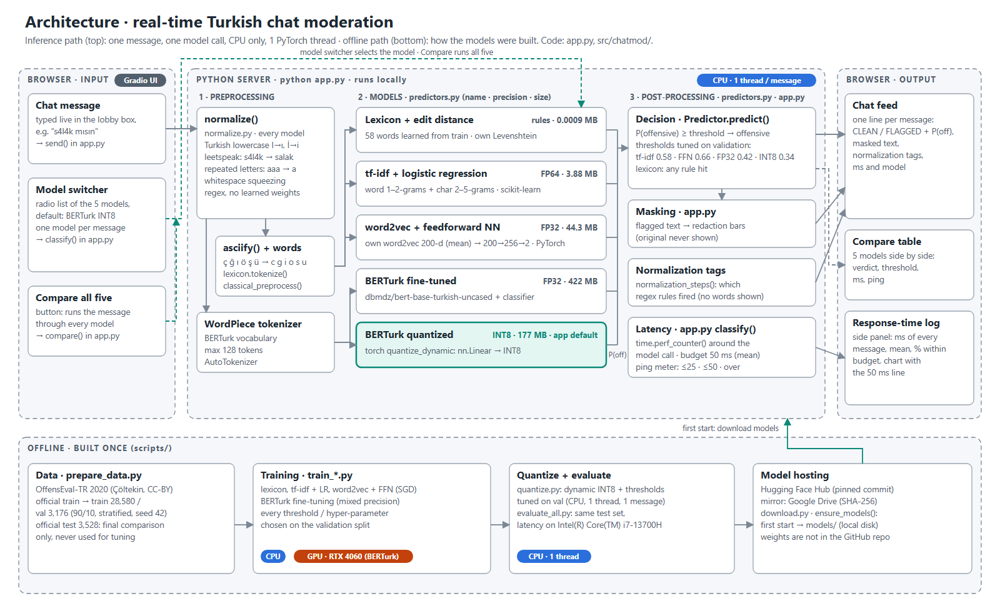

# Real-Time Chat Moderation (Turkish) — SWE015 Homework, Use Case 4

> **Content warning:** this project deals with offensive language. Examples in the app and in this README
> are mild or masked.

A gaming platform must flag offensive Turkish chat messages **within a strict time limit on a CPU-only
server**. This repository solves the task with a ladder of models of increasing sophistication, compares
them on the same held-out test set, and ships the **INT8-quantized BERTurk** inside a Gradio chat app:
every message is labeled live (clean / offensive) with its confidence score P(offensive), flagged messages
are masked, and a side panel logs the response time of every message and lets the user switch between models.



- **Demo video:** _link added at submission_
- **Trained models (Hugging Face Hub, 650 MB):** https://huggingface.co/mertcankaratas/turkish-chat-moderation
  (mirror: one 577 MB archive on [Google Drive](https://drive.google.com/file/d/1YgSwdN9ispbIZBIR4Ocdg_s6bcXh6YTL/view))

## Quick start

Requirements: Python 3.12 (tested on Windows 11), about 3 GB free disk (Python packages 2 GB + models 650 MB), internet for the first run.

```bash
git clone https://github.com/mertcankaratass/LLM-HW-Turkish-Chat-Moderation.git
cd LLM-HW-Turkish-Chat-Moderation
python -m venv .venv
.venv\Scripts\activate          # Windows   (macOS/Linux: source .venv/bin/activate)
pip install -r requirements.txt
python app.py
```

Open http://127.0.0.1:7860. On the first run the app downloads the trained models (650 MB) from the
Hugging Face Hub into `models/`, pinned to the exact commit that produced the results below. If the Hub
cannot be reached, it downloads the same files as one archive from the Google Drive mirror, checks its
SHA-256 checksum and extracts it. Later runs start directly.

**If the automatic download fails:** download `chatmod-models-v1.zip` from the Google Drive link above and
extract it into a folder named `models/` in the project root (so that `models/lexicon.json` exists), or
download the files of the Hugging Face repository into `models/`; then run `python app.py` again.

No GPU is needed: the app and all latency numbers run on the CPU, one core per message.

## Results

Official OffensEval-TR 2020 test set (3,528 tweets, 20.3 % offensive). Thresholds and hyper-parameters were
chosen on a validation split only. BERTurk scores one message at a time (batch size 1), exactly as in the
app (with dynamic quantization the INT8 output depends on the batch; the other models do not). Latency: CPU, mean of 300 messages after 20 warm-up runs,
13th Gen Intel Core i7-13700H, **1 PyTorch thread**. Budget: **50 ms mean per message on one CPU core**.

| Model | Precision | Macro-F1 | Size (MB) | Latency mean (ms) | Latency p95 (ms) | ≤ budget |
|---|---|---|---|---|---|---|
| Lexicon + edit distance (rule) | rules | 0.6703 | 0.0009 | 0.03 | 0.06 | yes |
| tf-idf + logistic regression | FP64 | 0.7726 | 3.88 | 0.81 | 1.09 | yes |
| word2vec + feedforward NN | FP32 | 0.6806 | 44.3 | 0.10 | 0.16 | yes |
| BERTurk (fine-tuned) | FP32 | 0.8224 | 422 | 63.97 | 117.54 | no |
| **BERTurk (dynamic quantization)** | **INT8** | **0.8157** | **177** | **32.78** | **62.97** | **yes** |

Dynamic INT8 quantization makes BERTurk 2.4× smaller and about 2× faster, bringing it under the one-core
budget for a macro-F1 change of −0.007. Generated by `scripts/evaluate_all.py` (`results/results_table.md`,
`results/results.json`); every macro-F1 can be recomputed from `results/test_predictions.csv`.

**Are the differences real?** Paired bootstrap on the test set (`scripts/significance.py`, 10,000 resamples):

| Model A | Model B | Macro-F1 A − B | 95 % interval | p | Significant (5 %) |
|---|---|---|---|---|---|
| BERTurk (fine-tuned) (FP32) | BERTurk (dynamic quantization) (INT8) | +0.0067 | [+0.0004, +0.0131] | 0.0352 | yes |
| BERTurk (dynamic quantization) (INT8) | tf-idf + logistic regression (FP64) | +0.0431 | [+0.0263, +0.0595] | 0.0000 | yes |
| BERTurk (fine-tuned) (FP32) | tf-idf + logistic regression (FP64) | +0.0498 | [+0.0329, +0.0666] | 0.0000 | yes |
| tf-idf + logistic regression (FP64) | word2vec + feedforward NN (FP32) | +0.0920 | [+0.0715, +0.1125] | 0.0000 | yes |
| word2vec + feedforward NN (FP32) | Lexicon + edit distance (rule) (rules) | +0.0104 | [-0.0128, +0.0337] | 0.3870 | no |

Quantization costs a small but statistically significant amount of macro-F1; both BERTurk models beat the
classical tf-idf baseline clearly. Our word2vec network does not beat the rule baseline significantly.

Latency depends on the number of CPU threads (separate run, `scripts/benchmark_threads.py`, 200 messages):

| CPU threads | BERTurk | Mean (ms) | p95 (ms) |
|---|---|---|---|
| 1 | FP32 | 60.56 | 113.03 |
| 1 | INT8 | 32.12 | 62.32 |
| 2 | FP32 | 38.00 | 64.10 |
| 2 | INT8 | 21.91 | 38.62 |
| 4 | FP32 | 25.64 | 44.60 |
| 4 | INT8 | 16.76 | 26.68 |

Laptop latency varies between runs (one-core FP32: 63.97 ms in the main evaluation, 60.56 ms in the thread
benchmark; INT8: 32.78 / 32.12 ms); FP32 missed and INT8 met the budget in both. Error analysis:
`results/error_analysis.json`, `results/error_examples.md` (tweet ids). Figures: `results/figures/`.

## Architecture



Generated from the code and the results by `scripts/make_architecture_diagram.py` (`docs/architecture.svg`).

## Techniques

| Area | Technique | Where |
|---|---|---|
| B – Classical NLP | Regex normalization: Turkish-aware lowercasing, leetspeak (`s4l4k`), repeated letters (`aptaaaal`), Turkish characters (`ı→i`, …) | `src/chatmod/normalize.py` |
| B – Classical NLP | Minimum edit distance (own Levenshtein) + offensive lexicon learned from the training split → rule baseline | `src/chatmod/lexicon.py`, `scripts/train_lexicon.py` |
| B – Classical NLP | tf-idf (word 1–2-grams + character 2–5-grams) + logistic regression → classical baseline | `scripts/train_tfidf.py` |
| A – Neural networks | Our own word2vec (skip-gram, trained on the training messages only) → averaged message vector → feedforward network trained with SGD + backpropagation | `src/chatmod/ffn.py`, `scripts/train_w2v_ffn.py` |
| C – Transformers | BERTurk (`dbmdz/bert-base-turkish-uncased`, WordPiece) fine-tuned with a classification head (GPU, mixed precision) | `scripts/train_bert.py` |
| D – Efficient models | Dynamic INT8 quantization (PyTorch, all `nn.Linear` layers); size / latency / accuracy benchmark; latency budget | `scripts/quantize.py`, `scripts/evaluate_all.py`, `scripts/benchmark_threads.py` |

## Reproducing everything

After `pip install -r requirements.txt` (the project itself is installed by the last line, `-e .`):

```bash
python scripts/prepare_data.py       # download OffensEval-TR 2020, checksum, train/val/test splits
python scripts/explore_data.py       # dataset statistics
python scripts/train_lexicon.py      # rule baseline (lexicon + edit distance), tuned on val
python scripts/train_tfidf.py        # tf-idf + logistic regression, tuned on val
python scripts/train_w2v_ffn.py      # own word2vec + feedforward network (SGD)
python scripts/train_bert.py         # BERTurk fine-tuning (NVIDIA GPU recommended; 3 epochs = 5.3 min on an RTX 4060)
python scripts/quantize.py           # dynamic INT8 quantization + BERTurk thresholds on val (CPU, 1 message)
python scripts/evaluate_all.py       # final comparison on the test set (results table)
python scripts/benchmark_threads.py  # latency with 1 / 2 / 4 CPU threads
python scripts/error_analysis.py     # confusion matrices, noisy subsets, error examples
python scripts/significance.py      # paired bootstrap test of the macro-F1 differences
python scripts/make_figures.py       # figures for the presentation
python scripts/make_architecture_diagram.py  # architecture diagram (docs/architecture.svg)
python scripts/upload_models.py     # upload the models to the Hugging Face Hub (needs `hf auth login`)
python scripts/package_models.py     # archive for the Google Drive mirror
python -m pytest                     # unit tests
```

`pip install -r requirements.txt` installs the CPU build of PyTorch on Windows; for GPU training install the
CUDA build first: `pip install torch==2.5.1 --index-url https://download.pytorch.org/whl/cu121`.

Splits: the official test set is used only for the final comparison; the official training set is split
90 / 10 (stratified, seed 42) into train (28,580) and validation (3,176).

## Project structure

```
app.py                  Gradio application (runs the INT8 model by default)
src/chatmod/            normalize.py · lexicon.py · ffn.py · predictors.py (common model interface) ·
                        download.py (model download) · common.py (paths, seed, threshold tuning)
scripts/                data preparation, training, quantization, evaluation, figures
tests/                  unit tests (normalization, edit distance / lexicon, model download) and integrity
                        tests (splits, published results reproduced by the downloaded models)
results/                result tables, JSON logs, error analysis, figures (all produced by scripts)
docs/                   app screenshot, architecture diagram
hub/                    model card of the Hugging Face repository
data/, models/          created locally (not in the repository)
```

## Limitations

- Implicit or sarcastic insults without offensive words are the most common missed case; heated but polite
  political tweets are the most common false alarm. Some dataset labels are debatable.
- Tweets written without Turkish characters: tf-idf (0.862) beats BERTurk FP32 (0.825) and INT8 (0.806) on this
  small subset (150 tweets).
- The lexicon is learned from data and inherits the dataset's bias (it contains some political / ethnic terms).
- INT8 p95 latency (63 ms) exceeds the budget; the budget is defined on the mean.
- Tweets are not game chat; the domain shift to real game chat is not measured.
- One tweet text appears in both the official training and test sets (it fell into our validation split).
- Failure examples from live tests: an insult written with dots between the letters (`e.z.*.*`) is not caught,
  because `normalize()` only joins letters around digits; a swear word with two letters swapped (`o****u`) is
  missed by all five models, while the correct spelling is flagged by all five (BERTurk's WordPiece splits the
  typo into three sub-word pieces; plain Levenshtein counts a swap as two edits). Next steps: join dotted
  spellings and count a swap as one edit (Damerau-Levenshtein).

## Data, models and libraries

- Çağrı Çöltekin. *A Corpus of Turkish Offensive Language on Social Media.* LREC 2020.
  https://coltekin.github.io/offensive-turkish/ — annotations CC-BY.
- Stefan Schweter. *BERTurk – BERT models for Turkish.* 2020. https://huggingface.co/dbmdz/bert-base-turkish-uncased
  (loaded from revision `refs/pr/1`, the safetensors conversion of the same weights).
- Jacob Devlin, Ming-Wei Chang, Kenton Lee, Kristina Toutanova. *BERT: Pre-training of Deep Bidirectional
  Transformers for Language Understanding.* NAACL 2019.
- Tomas Mikolov, Kai Chen, Greg Corrado, Jeffrey Dean. *Efficient Estimation of Word Representations in Vector
  Space.* 2013 (word2vec; trained here with gensim on our own training messages).
- PyTorch, Hugging Face Transformers and Hub, scikit-learn, gensim, Gradio, gdown, pandas, matplotlib.
